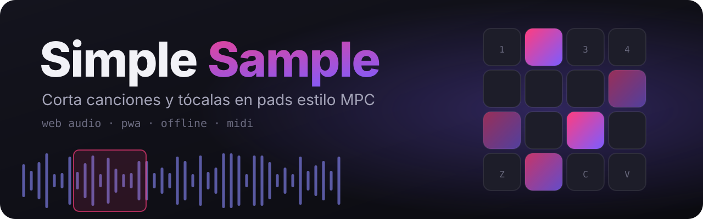

<p align="center">
  
</p>

<p align="center">
  <a href="https://hstev.github.io/simple-sample/"><b>▶ Abrir la app</b></a> ·
  <a href="#uso-sin-docker">Sin Docker</a> ·
  <a href="#uso-con-docker">Con Docker</a> ·
  <a href="CONTRIBUTING.md">Contribuir</a>
</p>

<p align="center">
  <a href="https://github.com/hstev/simple-sample/actions/workflows/pages.yml"></a>
  <a href="LICENSE"></a>
  
  
</p>

---

**Simple Sample** es un sampler web estilo MPC: importas una canción, la cortas, eliminas trozos, creas
slices y los tocas con pads asignados a tu teclado, pantalla táctil o controlador MIDI.

- 🎧 **100 % frontend estático**: todo el audio se procesa en tu dispositivo (Web Audio API). Sin backend ni APIs externas.
- 📱 **Mobile-first**: se adapta a móvil, tablet y desktop.
- 📦 **PWA**: instalable y funciona sin conexión. El proyecto se guarda solo en el navegador (IndexedDB).
- 🎹 **MIDI**: toca los pads desde un controlador (Web MIDI, en navegadores compatibles).

## Cómo se usa la app

1. **Importa** un MP3 (o WAV/OGG/M4A). Sin audio no se puede continuar.
2. **Editar**: arrastra sobre la onda para seleccionar. Puedes *Eliminar*, *Recortar* o *Crear pad*. Pellizca o usa la rueda para hacer zoom.
3. **Slices**: haz auto-chop en 4, 8 o 16 partes, o usa *Detectar golpes*. Los slices se asignan al banco activo.
4. **Pads**: tócalos con el dedo o con el teclado. Selecciona un pad para cambiar sonido, tecla (*Asignar tecla*), modo (one-shot/gate/loop), volumen, tono, grupo choke y reversa.

| Atajo | Acción |
|---|---|
| `1234 / QWER / ASDF / ZXCV` | Pads (pad 1 = `Z`, abajo a la izquierda) |
| `Espacio` | Play / pausa |
| `Supr` / `Retroceso` | Eliminar la selección |
| `Ctrl+Z` / `Ctrl+Shift+Z` | Deshacer / rehacer |
| `←` `→` | Cambiar de banco |

## Uso sin Docker

La forma más rápida es abrir la versión publicada: **<https://hstev.github.io/simple-sample/>**.
Se puede instalar como app desde el navegador y funciona offline.

### En local

Requiere **Node ≥ 22.12** (la CI usa Node 24). Con [nvm](https://github.com/nvm-sh/nvm): `nvm use`.

```sh
git clone git@github.com:hstev/simple-sample.git
cd simple-sample
npm install
npm run dev        # http://localhost:5173 (también accesible desde el móvil en tu red)
```

Otros comandos:

```sh
npm run build      # genera dist/ (sitio estático, sírvelo con cualquier servidor)
npm run preview    # sirve dist/ en local
npm run check      # chequeo de tipos
```

Para abrir la app con una canción ya cargada, copia el audio a `public/tracks/` (ignorada por git) y pasa su
ruta en `?track=`, por ejemplo `http://localhost:5173/?track=tracks/mi-cancion.mp3`.

## Uso con Docker

Docker es **opcional** y solo para uso local: agrega un atajo que descarga el audio de un video de YouTube
con `yt-dlp` y abre la app con la canción ya cargada. Requiere Docker y `curl`.

### Con el script

```sh
./simple-sample.sh "https://www.youtube.com/watch?v=…"   # descarga y abre la app con el track
./simple-sample.sh                                       # abre la app en la pantalla de importar
```

| Variable | Efecto |
|---|---|
| `PORT=9000` | Cambia el puerto (por defecto `8080`). |
| `REBUILD=1` | Reconstruye la imagen (la primera vez se construye sola). |
| `YTDLP_UPDATE=1` | Actualiza `yt-dlp` antes de descargar, si YouTube deja de funcionar. |

Los MP3 quedan en `./downloads`. Detén el servidor con `Ctrl+C`.

### Manualmente

```sh
docker build -t simple-sample -f docker/Dockerfile .

# Solo la app
docker run --rm -p 8080:8080 simple-sample

# Descargando una canción (se guarda en ./downloads)
docker run --rm -p 8080:8080 \
  --user "$(id -u):$(id -g)" -e HOME=/tmp \
  -v "$PWD/downloads:/app/tracks" \
  simple-sample "https://www.youtube.com/watch?v=…"
```

El contenedor imprime la URL a abrir (`http://localhost:8080/?track=tracks/…`).

> ⚠️ Descarga solo contenido sobre el que tengas derechos de uso.

## Despliegue en GitHub Pages

El workflow [`.github/workflows/pages.yml`](.github/workflows/pages.yml) corre `check` y `build` en cada
pull request y publica en GitHub Pages en cada push a `main` (Node 24; las actions se fuerzan a Node 24 porque Node 20 está deprecado en los runners).

Para activarlo la primera vez: en el repositorio, **Settings → Pages → Source: GitHub Actions**.
La ruta base (`/simple-sample/`) se toma del nombre del repositorio automáticamente.

### SEO y vista previa en redes

- `index.html` incluye título, descripción, canonical, Open Graph, tarjeta de X y datos estructurados
  (`WebApplication`). Las URLs absolutas salen de `SITE_URL` (por defecto `https://hstev.github.io/simple-sample/`);
  cámbiala al compilar si publicas en otro dominio: `SITE_URL=https://midominio.com/ npm run build`.
- El build genera `robots.txt` y `sitemap.xml` con esa misma URL.
- Las imágenes para redes y anuncios están en `public/social/` (1200×630, 1200×1200 y 1080×1920).
  Se regeneran con `npm run social-images` (usa `OG_FONT_DIR=<carpeta con los .ttf de Inter>` para la tipografía correcta).

## Contribuir

¡Las contribuciones son bienvenidas! Lee la [guía de contribución](CONTRIBUTING.md) para preparar el entorno,
el flujo de PRs y el estilo de código.

## Licencia

[MIT](LICENSE) © hstev
